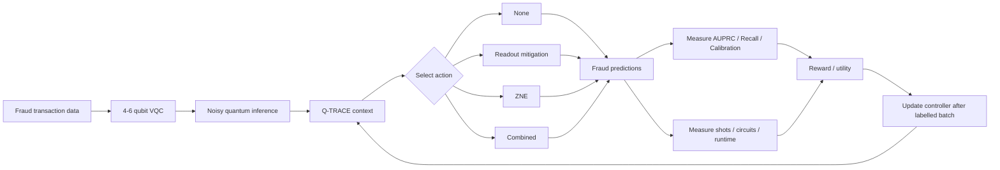
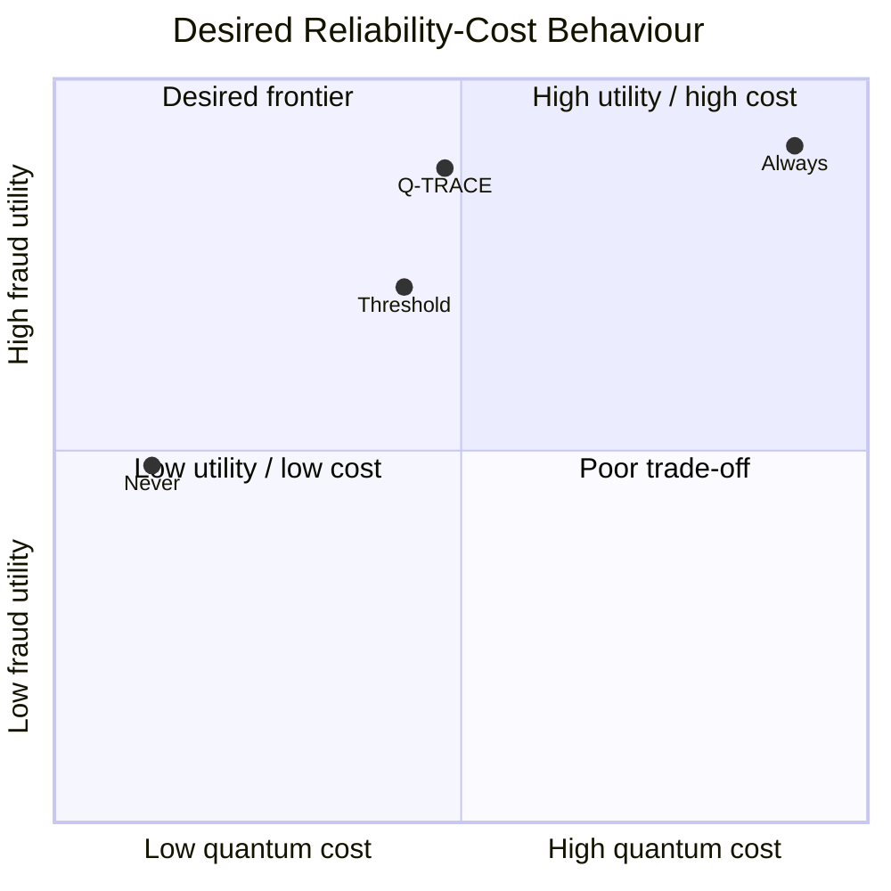
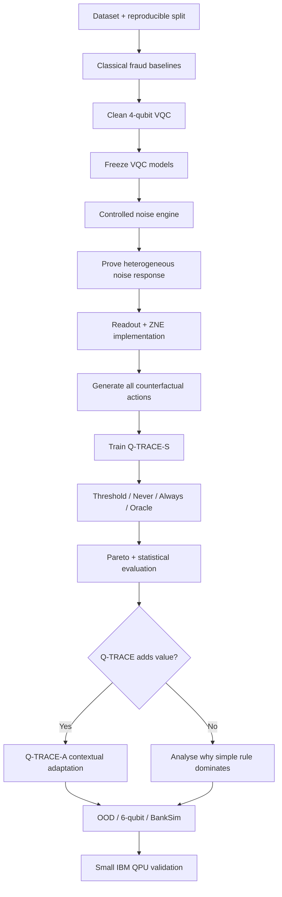
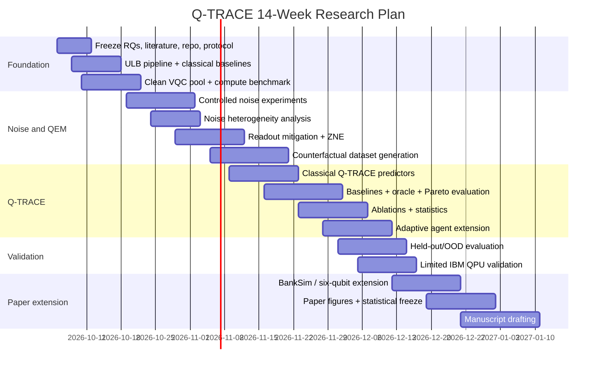

# Q-TRACE for Quantum Fraud Detection: Research, Experiment, Compute and Publication Plan

## Executive summary

The narrowed capstone is technically feasible and research-worthy:

> **Q-TRACE: an adaptive, cost-aware quantum error-mitigation controller for variational quantum fraud detection.**

The project should **not** claim novelty in quantum fraud detection, VQCs, adaptive QEM, machine-learning-based QEM, or contextual-bandit QEM individually. All of those now exist. Recent fraud studies already test VQCs under noise; machine-learning QEM has been demonstrated on hardware up to 100 qubits; 2026 work has introduced cost-aware contextual-bandit QEM for generic circuits and adaptive ZNE for VQCs; and work published only days ago selects among multiple QEM techniques adaptively in quantum reinforcement learning. citeturn15search1turn15search7turn16search0turn17academia42turn17academia43turn17academia44

The **defensible novelty boundary** is narrower:

> **Given a frozen VQC fraud detector, can observable model, circuit and noise characteristics predict the counterfactual downstream fraud-detection benefit of each available QEM action, so that an adaptive controller chooses None, readout mitigation, ZNE, or a combined intervention subject to a quantum-execution budget?**

That differs from work optimising generic quantum fidelity because Q-TRACE optimises a downstream, severely imbalanced fraud task—principally AUPRC, recall and calibration—while explicitly measuring the quantum-resource cost of the decision. It also differs from simply detecting noise: it asks **what would happen to fraud performance if a particular intervention were applied**, then acts on that counterfactual estimate.

This is a logical narrowing of your current presentation rather than a new capstone. The existing deck already establishes the benefit-minus-cost rule, VQC, Qiskit Aer, ZNE/readout mitigation and Never/Always/Fixed/Q-TRACE comparison; the principal change is replacing the broad Iris/QM9/WDBC scope with a single fraud application and making the mitigation decision more rigorous. fileciteturn0file0

### Overall assessment

| Question | Assessment |
|---|---|
| Is the capstone workable? | **Yes. High confidence at 4 qubits; 6 qubits as extension.** |
| Can the core be demonstrated by December 2026? | **Yes**, with strict scope: ULB dataset, 4-qubit VQC, three noise families + combined, None/Readout/ZNE/Combined, classical Q-TRACE. |
| Is a paper guaranteed? | **No.** Publishability depends on whether Q-TRACE beats simple policies and generalises. |
| Is there a plausible publication gap? | **Yes, but moderate and time-sensitive.** Recent adaptive-QEM papers make generic “agentic QEM” insufficiently novel. citeturn17academia42turn17academia43turn17academia44 |
| Strongest paper claim | **Fraud-task-specific counterfactual QEM action-value prediction + explicit resource constraint + OOD evaluation.** |
| Should the controller itself initially be quantum? | **No.** Use Logistic Regression/XGBoost/RF as primary baselines; optional VQC/QNN controller is an ablation. |
| Is an “agentic” version justified? | **Yes, as a batch-level adaptive contextual controller after the supervised system works.** |
| Primary dataset | **ULB/Kaggle European Credit Card Fraud dataset.** It contains 284,807 transactions and 492 frauds, or 0.172%. citeturn18search0 |
| Recommended quantum size | **4 qubits primary, 6 qubits robustness extension.** |
| Main local hardware | **M5 Pro MacBook is sufficient for development and most 4–6 qubit work.** Apple supports M5 Pro configurations up to 64 GB unified memory; Qiskit Aer's packaged GPU simulator is CUDA/Linux/x86-64, so the Mac should be treated as a CPU simulation machine. citeturn22search0turn21search1 |
| Main external compute | Local Mac + optional short GCP L4 or AWS GPU/CPU bursts; do not design around GPU availability. |
| Real QPU | **Validation only.** IBM's Open Plan currently provides up to 10 QPU minutes per rolling 28-day window. citeturn14search0 |
| Capstone time | About **9–10 weeks** to a strong December result. |
| Paper-quality study | **12–16 weeks / roughly 3–4 months** including stronger statistics, OOD tests and hardware validation. |

The most important scientific rule is:

\[
\boxed{\text{Q-TRACE is a hypothesis, not an assumed solution.}}
\]

A result in which a simple threshold performs equally well would **reject the need for the ML controller**. That is not a project failure; it is the correct outcome of a well-designed research study.



## Research question, hypotheses and novelty

### Precise research question

The primary research question should be frozen as:

> **Can model-, circuit-, and noise-specific information predict the counterfactual downstream benefit of quantum error mitigation for a VQC-based fraud detector well enough to select a mitigation strategy under a resource constraint and achieve a better fraud-performance–cost trade-off than never mitigating, always mitigating, or using a fixed noise threshold?**

The project therefore does **not** predict merely:

\[
P(\text{noise is harmful})
\]

It predicts, for each action \(a\),

\[
\widehat{\Delta M}_a(X)
=
E[M(Y,a)-M(Y,\text{None})\mid X]
\]

where \(M\) is a fraud-performance measure, initially AUPRC or a task utility, and \(X\) contains information available **before** the mitigation decision.

The action space is:

\[
\mathcal A=
\{
\text{None},
\text{Readout},
\text{ZNE},
\text{Combined}
\}.
\]

PEC should be an **exploratory fifth action**, not part of the minimum viable experiment. IBM's current documentation notes that PEC can be unbiased but has sampling overhead related to quasi-probability negativity, with overhead growing rapidly with circuit depth; this makes it a poor compulsory intervention for a budget-limited student project. citeturn20search0turn16search4

### Two decision formulations

The simple form retained from your existing presentation is:

\[
U(a|X)=\widehat{\Delta M}_a-\lambda C_a
\]

and

\[
a^*=\arg\max_a U(a|X).
\]

For a stronger paper, I recommend adding a **true budget-constrained formulation**:

\[
\max_\pi E[M(\pi(X))]
\]

subject to

\[
E[C(\pi(X))]\le B.
\]

That answers a more practically meaningful question:

> “Given only a fixed mitigation budget, where should we spend it?”

rather than relying entirely on an arbitrary \(\lambda\).

### The hypotheses

The hypotheses should be frozen before the final experiment.

**Heterogeneity hypothesis**

\[
H_1:\quad
\operatorname{Var}(\Delta M_a\mid X)>0
\]

in a practically meaningful way across models and noise regimes.

This is necessary: if mitigation produces approximately the same value everywhere, a selective controller is unnecessary. Recent QML research gives a strong reason to test this rather than assume uniform noise behaviour. Zhu et al. report heterogeneous, initialisation-dependent responses among identically structured QGNNs; approximately one-third improved under moderate noise in their effective model, with baseline performance correlated with noise benefit at \(r=-0.62\). citeturn19search7

**Predictability hypothesis**

\[
H_2:
\widehat{\Delta M}_a(X)
\]

predicts unseen action benefits substantially better than a constant predictor and a noise-strength-only predictor.

A reasonable *provisional* success target is at least **10% relative reduction in MAE** against the best simple predictor on held-out model instances. Freeze or revise that threshold after the pilot—not after final results are visible.

**Selective-mitigation hypothesis**

\[
H_3:
M_{\text{QTRACE}}
\ge
M_{\text{Always}}-\epsilon
\]

while

\[
C_{\text{QTRACE}}
<
C_{\text{Always}}.
\]

For the initial protocol, \(\epsilon=0.02\) absolute AUPRC can be treated as a provisional practical tolerance, but the pilot should determine whether that is sensible for the observed VQC operating range.

A second operational criterion should be:

\[
\frac{C_{\text{Always}}-C_{\text{QTRACE}}}
{C_{\text{Always}}}
\ge 30\%
\]

as an ambitious resource-saving target, not a guaranteed result.

**Learned-policy hypothesis**

\[
H_4:
U_{\text{QTRACE}}>U_{\text{Threshold}}
\]

with the 95% confidence interval for the paired difference excluding zero.

This is arguably the most important hypothesis. Beating Never and Always is not enough; Q-TRACE must justify itself over a rule that says:

> “Use ZNE when estimated gate error exceeds \(t\).”

**Oracle-recovery hypothesis**

Define

\[
R_{\text{oracle}}
=
\frac{
U_{\text{QTRACE}}-U_{\text{Never}}
}{
U_{\text{Oracle}}-U_{\text{Never}}
}.
\]

A strong result would recover a large fraction—perhaps **≥80% as an aspirational criterion**—of the value available to an oracle that already knows the true counterfactual outcomes.

### What “agentic” should mean

Do **not** use an LLM agent for the core scientific contribution.

The scientifically defensible agent is a **closed-loop decision policy**:

\[
S_t\rightarrow A_t\rightarrow R_t\rightarrow S_{t+1}.
\]

However, fraud labels are often not known immediately. Therefore Q-TRACE should not pretend to learn a reward after every card transaction. The realistic adaptive unit is a **labelled batch or operational epoch**:

```text
Observe current circuit + noise context
             ↓
Select mitigation strategy
             ↓
Process a batch
             ↓
Fraud labels eventually become available
             ↓
Measure downstream benefit + cost
             ↓
Update policy for the next batch
```

This distinction matters for publication credibility.

The capstone should therefore have two controllers:

**Q-TRACE-S**, the compulsory supervised counterfactual controller trained offline; and **Q-TRACE-A**, an optional adaptive contextual-bandit extension once Q-TRACE-S is validated.

### Literature matrix and novelty boundary

The literature is now crowded enough that the paper must position itself carefully.

| Priority | Paper | Year / venue | Key contribution | Gap relative to Q-TRACE |
|---|---|---|---|---|
| ★★★★★ | **Comparative Analysis and Noise Robustness Study of Quantum Kernel Methods and VQCs for Financial Fraud Detection** | 2026, *Electronics* | ULB fraud; common 4-qubit PCA space; 15 fits; VQC/QSVM vs classical models; depolarising-noise study; AUPRC primary. VQC AUPRC is reported as non-monotonic under noise. citeturn15search1 | **Closest fraud starting point.** Does not learn counterfactual QEM value or select interventions. |
| ★★★★★ | **Comparative performance analysis of QML architectures for credit-card fraud detection** | 2026, *Applied Intelligence* | VQC, SQNN and EQNN across two fraud datasets; architecture study and robustness under five quantum-noise types. citeturn15search7 | Noise robustness, not adaptive cost-aware QEM. |
| ★★★★☆ | **Evaluating the computational advantages of the VQC model in Financial Fraud Detection** | 2024, *IEEE Access* | VQC fraud study on a large bank transaction dataset; classical comparisons and NISQ-oriented dimensionality reduction. citeturn3search1 | No action-specific QEM controller. |
| ★★★★☆ | **QFDNN: A Resource-Efficient Variational Quantum Feature Deep Neural Networks for Fraud Detection and Loan Prediction** | 2025, *IEEE TCSS* | Resource-efficient quantum fraud architecture and robustness under six noise models. citeturn15search0 | Builds a robust classifier rather than deciding when/how to mitigate. |
| ★★★★☆ | **Unsupervised quantum machine learning for fraud detection** | 2022, arXiv | Quantum-kernel anomaly detection for fraud, simulated up to 20 qubits; average precision emphasised. citeturn15academia44 | Quantum anomaly detection, not QEM orchestration. |
| ★★★☆☆ | **HQRNN-FD: A Hybrid Quantum Recurrent Neural Network for Fraud Detection** | 2025, *Entropy* | VQC/recurrent hybrid and experiments under depolarising, bit-flip and phase noise. citeturn15search12 | Focuses model robustness, not intervention utility. |
| ★★★★★ | **Rethinking noise in quantum machine learning: When noise improves learning** | 2026, *APL Computational Physics* | QGNN study finds strongly heterogeneous, initialisation-dependent noise response and reports some noise-beneficial cases. citeturn19search7 | Direct motivation for **model-specific**, not universal, mitigation. |
| ★★★★☆ | **Noisy HQNNs: A Comprehensive Analysis of Noise Robustness in Hybrid QNNs** | 2025, arXiv | Five noise channels and architecture-dependent robustness; some settings benefit from noise. citeturn18academia36 | No QEM selection policy. |
| ★★★★★ | **Robustness Evaluation of HQNNs under Noise Models via System-Level Error Mitigation** | 2026, arXiv | Compares ZNE, DDD, LRE and PEC; mitigation benefit is strongly noise-model- and strength-dependent. citeturn18academia38 | Strong motivation for action selection, but not fraud-task-specific cost-constrained policy. |
| ★★★★☆ | **Learning-Based Quantum Error Mitigation** | 2021, *PRX Quantum* | Learns a compensation strategy from training circuits and validates it on simulated and IBM hardware noise. citeturn16search1 | Learns QEM itself, not whether intervention improves a downstream fraud model enough to justify cost. |
| ★★★★☆ | **Scalable error mitigation for noisy quantum circuits produces competitive expectation values** | 2023, *Nature Physics* | Demonstrates scalable ZNE on circuits up to 26 qubits and deep entangling circuits. citeturn16search2 | Establishes ZNE capability; no application-aware selective controller. |
| ★★★★☆ | **Probabilistic error cancellation with sparse Pauli–Lindblad models** | 2023, *Nature Physics* | Practical PEC using learned sparse noise models on superconducting processors. citeturn16search4 | PEC is an intervention candidate, not a task-level policy. |
| ★★★★★ | **Machine learning for practical quantum error mitigation** | 2024, *Nature Machine Intelligence* | Linear/RF/MLP/GNN models learn QEM behaviour; demonstrations extend to hardware experiments and circuits up to 100 qubits while targeting QEM overhead. citeturn16search0 | Major novelty constraint: “ML for QEM” alone is already established. |
| ★★★★☆ | **Real-time error mitigation for variational optimization on quantum hardware** | 2026, *Physical Review Research* | Integrates real-time mitigation with variational optimisation on quantum hardware. citeturn17search0 | Makes “real-time QEM for variational models” non-novel by itself. |
| ★★★★★ | **GSC-QEMit** | 2026, IJCNN/arXiv | Telemetry + forecasting + cost-aware contextual bandit selects mitigation intensity for GHZ/QFT/Grover workloads. citeturn17academia42 | **Direct threat** to generic adaptive/cost-aware-QEM novelty. Its objective/workloads are not downstream fraud classification. |
| ★★★★★ | **Quantum Noise Mitigation with Adaptive ZNE: A Contextual Multi-Armed Bandits Approach** | 2026, arXiv | VQC-aware contextual bandit dynamically selects ZNE folding levels; reports reduced execution round trips and end-to-end cost. citeturn17academia43 | **Direct threat** to “agent + VQC + ZNE + cost” novelty. Q-TRACE must go beyond adaptive folding. |
| ★★★★★ | **Context-Aware Error Mitigation Orchestration for Hybrid QRL on NISQ Systems** | Oct. 2026, arXiv | Selects among ZNE, PEC, CDR and readout mitigation using learning-level indicators and utility; reports performance close to oracle in QRL. citeturn17academia44 | **Strongest multi-action novelty threat.** Q-TRACE needs fraud-specific counterfactual task utility, resource constraints and strong OOD analysis. |
| ★★★☆☆ | **Machine Learning of Noise-Resilient Quantum Circuits** | 2021, *PRX Quantum* | Uses ML to optimise circuits against task-specific device noise. citeturn16search7 | Further evidence that “AI makes quantum computation noise aware” is too broad a novelty claim. |

The literature therefore rules out claims such as:

> “First AI system for adaptive QEM.”

> “First cost-aware QEM.”

> “First adaptive QEM for VQCs.”

> “First multi-action QEM agent.”

Those are not defensible in October 2026. citeturn17academia42turn17academia43turn17academia44

The strongest credible contribution is instead:

\[
\boxed{
\begin{array}{c}
\text{Fraud-specific downstream task utility}\\
+\\
\text{Counterfactual benefit prediction for each QEM action}\\
+\\
\text{Explicit execution budget}\\
+\\
\text{Unseen-model/noise generalisation}\\
+\\
\text{Oracle + simple-policy comparisons}
\end{array}}
\]

I would rate the current novelty opportunity **moderate, not high**, because adaptive QEM is moving very rapidly in 2026. The paper becomes materially stronger if Q-TRACE adds uncertainty-aware action values or an explicit constrained optimisation formulation rather than only \(Benefit-\lambda Cost\).

## Dataset, quantum model and experimental protocol

### Dataset recommendation

The **ULB European Credit Card Fraud dataset should be the primary and compulsory dataset**.

The dataset distributed by the ULB Machine Learning Group on Kaggle contains 284,807 European card transactions collected over two days in September 2013, with 492 fraudulent transactions—0.172% of the data. `V1`–`V28` are anonymised PCA components; `Time` and `Amount` remain outside that original PCA transformation. Kaggle itself recommends AUPRC rather than ordinary accuracy because of the extreme imbalance. citeturn18search0

Important clarification:

> **“ULB Credit Card Fraud” and the well-known Kaggle `mlg-ulb/creditcardfraud` dataset are the same dataset, not two independent validations.** citeturn18search0

This dataset is especially defensible because the June 2026 VQC/QSVM study already establishes a reproducible 4-qubit fraud benchmark on it, including controlled quantum noise. citeturn15search1

Secondary options are:

| Dataset | Role | Recommendation |
|---|---|---|
| **ULB/Kaggle European CCF** | Primary real transaction benchmark | **Use compulsorily.** |
| **BankSim** | Synthetic external validation | Useful if time allows. Published analyses describe 594,643 simulated transactions with 7,200 frauds. citeturn18search14 |
| **PaySim** | Large-scale synthetic mobile-money fraud | Optional only; useful for transfer/generalisation, unnecessary for core capstone. |
| Kaggle “Transaction Fraud Detection” | Modern simulated dataset with >1.4M train transactions | Optional. Current competition data are simulated and licensed MIT; use only after documenting provenance carefully. citeturn18search6 |
| Random “Credit Card Fraud 2023” Kaggle datasets | Secondary at best | **Do not base publication claims on them unless provenance can be independently documented.** |

For the December capstone, **one primary real-data benchmark plus one synthetic external-validation dataset is enough**.

### Transaction preprocessing

For ULB:

1. Keep `V1`–`V28`, `Time`, and `Amount`.
2. Apply `log1p` or a robust transformation to `Amount`.
3. Standardise/robust-scale `Time` and `Amount`.
4. Fit all transformations **only on the training partition**.
5. Compare two reduction methods:
   - PCA → 4 or 6 dimensions;
   - supervised train-only feature selection → top 4 or 6.
6. Map resulting features into a bounded angle range for quantum encoding.
7. Undersample legitimate transactions **only inside the training partition**.
8. Leave evaluation prevalence untouched where computationally possible; where transaction subsampling is unavoidable, retain sampling probabilities and use inverse-probability/sample weighting when estimating population-level metrics.

A useful development configuration is approximately **1,000–2,000 VQC training transactions**, containing all available training fraud examples plus 3–5 legitimate examples per fraud. Do not run the complete 284,807-row dataset through every noisy/mitigated quantum condition.

The June 2026 ULB VQC paper likewise reduced the problem to four dimensions/qubits and preserved the naturally imbalanced population for its test evaluation, which makes it an excellent replication baseline. citeturn15search1

### Leakage protection

There are **two distinct levels of leakage**.

For the fraud detector, preprocessing, dimensionality reduction and any undersampling must be learned solely from the training data.

For Q-TRACE, leakage is even more important:

```text
VQC seed/model #17 @ low depolarising noise
→ training

VQC seed/model #17 @ high depolarising noise
→ test
```

is not a strong generalisation test because Q-TRACE may recognise properties of model #17.

The **group key should therefore be the frozen VQC model instance**.

Primary meta-split:

```text
Q-TRACE train:
VQC model IDs 1–24

Q-TRACE validation:
VQC model IDs 25–32

Q-TRACE final test:
VQC model IDs 33–40
```

Harder tests should hold out:

- unseen model seeds;
- one noise severity;
- optionally an entire noise family;
- the 6-qubit architecture;
- BankSim, if the secondary dataset is completed.

### VQC architecture

Use a small controlled architecture rather than trying many fashionable QML models.

**Primary 4-qubit model**

\[
\text{4 reduced features}
\rightarrow ZZFeatureMap
\rightarrow \text{variational ansatz}
\rightarrow \text{binary fraud score}.
\]

Compare:

- `RealAmplitudes`, reps 1 and 2;
- `EfficientSU2`, reps 1 and 2.

These families are particularly defensible because the recent ULB fraud study uses VQC architectures based on EfficientSU2/RealAmplitudes in its four-qubit benchmark. citeturn15search1

Use approximately ten random initialisation seeds per architecture/depth combination, giving:

\[
2 \text{ ansätze}
\times
2 \text{ depths}
\times
10 \text{ seeds}
=
40
\]

frozen model instances.

Partition them:

\[
24\text{ train-meta}
+
8\text{ validation-meta}
+
8\text{ final-test}.
\]

**Six qubits are an extension, not a requirement.**

The 6-qubit result should answer:

> “Does the learned mitigation policy survive a change in feature/circuit dimensionality?”

Do not make it necessary for finishing the capstone.

### Training versus inference noise

For the cleanest causal experiment, **train the VQC first, freeze its parameters, then apply noise/QEM during inference**.

That isolates:

\[
\text{effect of noise}
\]

and

\[
\text{effect of mitigation}
\]

without confounding them with a separate training-under-noise phenomenon.

Noisy training can become a later ablation.

### Noise models

Qiskit Aer provides explicit depolarising, readout and thermal-relaxation models, and `NoiseModel.from_backend()` can build approximate device-derived noise models containing depolarising gate errors, thermal relaxation and readout error. citeturn21search0turn21search2

Use the following controlled grid. These are **experimental conditions**, not claims that every IBM processor has these exact error rates.

| Family | Low | Medium | High |
|---|---:|---:|---:|
| 1-qubit depolarising \(p_1\) | 0.0005 | 0.001 | 0.003 |
| 2-qubit depolarising \(p_2\) | 0.005 | 0.010 | 0.020 |
| Symmetric readout flip | 0.005 | 0.020 | 0.050 |
| Thermal \(T_1\) | 200 μs | 100 μs | 50 μs |
| Thermal \(T_2\) | 250 μs | 150 μs | 70 μs |

The thermal values satisfy Qiskit Aer's physical requirement \(T_2\le 2T_1\). citeturn21search9

Define twelve core noise profiles:

\[
3\ \text{depolarising}
+
3\ \text{readout}
+
3\ \text{thermal}
+
3\ \text{combined}
=
12.
\]

Then add one or two **backend-derived noise snapshots** as a realism check, rather than pretending synthetic channels fully reproduce hardware.

### Mitigation actions

The core action set should be:

| Action | Meaning | Approximate overhead concept |
|---|---|---|
| **None** | Execute noisy circuit normally | \(1\times\) baseline |
| **Readout** | Measurement/readout mitigation | calibration + corrected measurement |
| **ZNE** | Noise factors, initially \(1,3,5\), then extrapolate | roughly proportional to number of factors |
| **Combined** | Readout mitigation + ZNE | higher than either alone |

IBM's current ZNE implementation amplifies noise and extrapolates expectation values toward zero noise; its default three-noise-factor configuration corresponds to roughly \(3\times\) sampling overhead. IBM explicitly notes that ZNE is not guaranteed to give an unbiased result. citeturn20search0

PEC belongs in a small feasibility experiment only:

\[
\mathcal{A}_{extension}
=
\mathcal A\cup\{\text{PEC}\}.
\]

IBM currently supports PEC but warns of significantly greater sampling overhead, with its quasi-probability overhead related to circuit depth. citeturn20search0

### What Q-TRACE sees

The current presentation shows “current accuracy” as an example input. That should **not** be part of the normal online feature vector because true accuracy requires labels that may not yet exist. fileciteturn0file0

Use observable features such as:

\[
X=[
p_1,p_2,p_{readout},T_1,T_2,
n_q,
depth,
N_{1q},
N_{2q},
shots,
ansatz,
reps,
\text{prediction entropy},
\text{shot variance},
\text{historical validation score}
].
\]

Recent labelled-batch performance can be used by the adaptive controller, but not future labels.

### Counterfactual labels

For every context \(x\), run all available actions **during dataset generation**:

\[
M_{\text{None}},
M_{\text{Readout}},
M_{\text{ZNE}},
M_{\text{Combined}}.
\]

Then:

\[
\Delta_a=M_a-M_{\text{None}}.
\]

This creates the counterfactual training set.

At deployment, of course, Q-TRACE sees only \(X\), predicts all \(\widehat{\Delta}_a\), and executes **one** chosen action.

### Classical and quantum decision models

The primary comparison should be:

| Controller | Purpose |
|---|---|
| Constant mean | trivial regression baseline |
| Noise-only linear model | tests whether sophisticated features are unnecessary |
| Logistic/linear regression | interpretable classical baseline |
| Random Forest | nonlinear baseline |
| **XGBoost** | primary classical Q-TRACE |
| Small MLP | optional |
| **VQC/QNN controller** | optional quantum-controller ablation |

Do **not** make the quantum controller compulsory.

If the decision itself requires another QPU call, its cost becomes:

\[
C_{\text{total}}
=
C_{\text{fraud VQC}}
+
C_{\text{decision QNN}}
+
C_{\text{selected QEM}}.
\]

A classical controller winning may actually be the more interesting engineering result.

### Policy baselines

The final paper requires:

\[
\boxed{\text{Never}}
\]

\[
\boxed{\text{Always-ZNE}}
\]

\[
\boxed{\text{Always-best-fixed-action}}
\]

\[
\boxed{\text{Noise threshold}}
\]

\[
\boxed{\text{Q-TRACE-S}}
\]

\[
\boxed{\text{Q-TRACE-A, optional}}
\]

\[
\boxed{\text{Oracle}}
\]

The oracle computes:

\[
a^*_{\text{oracle}}
=
\arg\max_a
\left[
M_a-\lambda C_a
\right]
\]

using outcomes that would never be available at inference time.

Its purpose is to answer:

> **How much selective-mitigation opportunity exists at all?**

### Metrics

Fraud performance should use:

**Primary**

\[
\boxed{\text{AUPRC}}
\]

because extreme class imbalance makes ordinary accuracy misleading; both the ULB dataset documentation and recent VQC fraud work emphasise precision-recall evaluation. citeturn18search0turn15search1

Secondary:

- recall;
- precision;
- F1/F2;
- recall at fixed precision;
- precision at top-\(K\);
- Brier score;
- expected calibration error;
- AUROC, but not as headline metric.

The recent 2026 ULB study is particularly instructive: its VQC AUPRC improved at moderate depolarising noise even as ranking preservation deteriorated, illustrating why a single metric can mischaracterise noise response. citeturn15search1

For the QEM-benefit regressor:

\[
MAE,\ RMSE,\ R^2,\ \rho_{\text{Spearman}}.
\]

This is where **MAE** belongs. Fraud itself is a classification problem, so MAE is not the main fraud metric.

For policy evaluation:

\[
\text{AUPRC},
\quad
\text{intervention rate},
\quad
\text{shots},
\quad
\text{circuit executions},
\quad
\text{wall time},
\quad
\text{cost saving},
\quad
\text{oracle regret}.
\]

Define a reproducible execution-equivalent cost such as:

\[
C=
\frac{
\text{total shots across mitigation/calibration circuits}
}{
\text{shots required for unmitigated inference}
}.
\]

Wall time should be reported separately because simulator speed is hardware-dependent.

### Ablations

The minimum useful ablations are:

| Ablation | Scientific question |
|---|---|
| Q-TRACE − model features | Does the identity/state of the VQC matter? |
| Q-TRACE − circuit features | Do depth/gate counts add predictive information? |
| Q-TRACE − noise features | Can benefit be inferred without explicit noise knowledge? |
| Q-TRACE − uncertainty/shot features | Does stochastic measurement information matter? |
| Q-TRACE noise-only | Does a simple noise rule explain almost everything? |
| Q-TRACE − cost | Does explicit cost-awareness change the selected actions? |
| binary None/ZNE only | Is multi-action orchestration actually useful? |
| classical vs quantum controller | Is another quantum model justified? |
| static vs adaptive controller | Is “agentic” adaptation actually useful? |

### Performance–cost objective

The final result should be a **Pareto comparison**, not a single cherry-picked \(\lambda\).

The following diagram is conceptual; its positions are **not experimental results**.



The desired result is not necessarily:

\[
M_{\text{QTRACE}}>M_{\text{Always}}.
\]

It is:

\[
\boxed{
M_{\text{QTRACE}}\approx M_{\text{Always}}
\quad\text{at materially lower}\quad
C_{\text{QTRACE}}
}
\]

and:

\[
\boxed{
U_{\text{QTRACE}}>U_{\text{Threshold}}.
}
\]

### Experiment matrix

A full Cartesian product should **not** be executed. Use progressive stages and cache everything.

| Stage | Dimensions | Count | Transaction panel | Purpose |
|---|---|---:|---:|---|
| VQC pool | 2 ansätze × 2 depths × 10 seeds | **40 frozen VQCs** | 1k–2k train | Model heterogeneity |
| Meta-train allocation | 4 configurations × 6 seeds | **24 VQCs** | — | Q-TRACE training |
| Meta-validation | 4 configurations × 2 seeds | **8 VQCs** | — | Hyperparameters |
| Meta-test | 4 configurations × 2 seeds | **8 VQCs** | — | Completely unseen model instances |
| Core counterfactual map | 24 models × 12 noise profiles × 4 actions | **1,152 action evaluations** | 256 | Main QEM-benefit dataset |
| Finite-shot sensitivity | 48 selected contexts × 2 shot budgets × 4 actions | **384 action evaluations** | 128 | Sampling uncertainty/cost |
| Held-out policy evaluation | 8 unseen models × 8 test noise profiles × 4 actions | **256 action evaluations** | 128–256 | Final policy result |
| 6-qubit extension | selected models/noises only | **64–128 evaluations** | 128 | Architecture shift |
| IBM validation | ~4 contexts × 3 actions × 2 repeats | **24 logical bundles** | 16–32 examples | Hardware sanity check |

The core simulator total is therefore around:

\[
1152+384+256
\approx1792
\]

logical action evaluations before optional extensions.

ZNE turns one logical action evaluation into several physical circuit evaluations; readout calibration also adds shared calibration work. IBM's three-factor ZNE alone gives approximately threefold sampling overhead. citeturn20search0

The finite-shot sweep can still become very large. At 4–6 qubits the state representation itself is tiny; the real bottleneck is **repeated data points × shots × noise trajectories × ZNE factors**, not memory. Therefore the first engineering milestone must benchmark throughput before committing to every row in this matrix.

## Compute, hardware and implementation architecture

### Local MacBook M5 Pro

The M5 Pro MacBook is more than sufficient for Git development, preprocessing, XGBoost/RF, 4-qubit VQC experiments, exact/noiseless VQC training, unit tests, small noisy sweeps and experiment orchestration. Current M5 Pro configurations support up to 64 GB unified memory and Apple reports memory bandwidth up to 307 GB/s. citeturn22search0turn22search2

However, do **not** plan around the Apple GPU for Qiskit Aer. Qiskit's prebuilt GPU-supported simulator package targets CUDA-enabled **x86-64 Linux**; GPU acceleration covers statevector, density-matrix and unitary methods. citeturn21search1turn21search3

So:

> **Mac = strong CPU workstation for this capstone.**

At 4–6 qubits, that is fine.

### CPU versus GPU

A six-qubit statevector contains only:

\[
2^6=64
\]

complex amplitudes.

A six-qubit density matrix contains:

\[
4^6=4096
\]

complex entries.

Using 16-byte complex numbers, those raw states require roughly 1 KB and 64 KB respectively. Hence 32–64 GB GPUs are unnecessary for *memory* at this circuit size.

GPU acceleration becomes attractive only because you may execute very many trajectories/circuits. Even then, GPU kernel-launch and batching overhead can mean CPU parallelism is competitive for tiny circuits. The correct choice must therefore come from a benchmark, not an assumption.

### Recommended compute ladder

| Platform | Useful resources | Recommended role | Planning wall-time for core sweeps* | Cost planning |
|---|---|---|---:|---:|
| **MacBook M5 Pro** | 15/18-core class M5 Pro depending configuration; 24–64 GB unified memory | Development, VQC training, first complete experiment | ~30–100 cumulative hours | Already owned; **$0 incremental**. Apple supports up to 64 GB. citeturn22search0turn22search2 |
| **Free Colab** | Resources vary; GPU availability and usage limits are not guaranteed | Small parallel jobs, notebooks, sanity checks | Unreliable for unattended full sweep | **$0**. Google explicitly says resources are not guaranteed/unlimited and limits fluctuate. citeturn21search4 |
| **Colab Pro** | Higher-priority hosted resources but still dynamic | Convenient burst compute, not canonical reproducibility environment | Split jobs into ≤few-hour chunks | Budget roughly one month of subscription; check current regional checkout rather than hard-coding a price |
| **GCP `g2-standard-4`** | 4 vCPU, 16 GiB RAM, **1× NVIDIA L4** | Reproducible CUDA Aer benchmark / parallel batches | ~20–60 instance-hours depending measured speed | Google currently lists about **$0.7068/h** for one pricing configuration; 40 h ≈ **$28.27**, 100 h ≈ **$70.68** before storage/network. citeturn14search2 |
| **GCP `g2-standard-8`** | 8 vCPU, 32 GiB, L4 | More CPU feeding same GPU / bigger batches | ~15–50 h | Current listed rate in one pricing configuration ≈ **$0.8536/h**. citeturn14search8 |
| **AWS G5 family** | NVIDIA A10G-class accelerated instances; choose an x86 G5 instance, not ARM G5g, for packaged Aer CUDA | Alternative to GCP | Benchmark first | Use a planning allowance around **$1–1.2/h** for a small G5 configuration, but verify live regional AWS pricing before launch; do not reserve long instances before benchmarking |
| **CPU-only cloud** | 16–32 vCPU, 32–64 GB | Often the best choice for many independent 4-qubit circuits | Potentially cheaper than GPU | Select only after Mac-vs-cloud throughput benchmark |

\*These are **engineering planning estimates, not measured Q-TRACE runtimes**. Week-one benchmarking must replace them with measured transactions/circuits per second.

A sensible student budget is therefore:

\[
\$0\text{–}\$30
\]

for a local-first capstone, or approximately:

\[
\$30\text{–}\$100
\]

for comfortable cloud bursting, excluding optional subscriptions.

There is no reason to budget hundreds or thousands of dollars at 4–6 qubits unless the experiment is poorly controlled.

### IBM hardware validation

IBM's Open Plan currently provides up to **10 minutes of QPU usage per rolling 28-day window**, and IBM also announced an opt-in 2026 promotion giving active Open Plan users additional access; the project should rely only on the regular quota unless extra access is confirmed. citeturn14search0

Do not hard-code a device months in advance.

At run time:

```python
backend = service.least_busy(
    operational=True,
    simulator=False,
    min_num_qubits=6,
)
```

and record:

- backend name;
- processor revision;
- calibration timestamp;
- layout;
- gate errors;
- readout errors;
- \(T_1/T_2\);
- queue information;
- Qiskit versions.

IBM's 2026 fleet includes upgraded Heron r3 systems such as `ibm_boston`, `ibm_pittsburgh`, and `ibm_aachen`; IBM's processor documentation also lists Heron and newer Nighthawk revisions. Availability under a particular account/plan must be checked at execution time. citeturn22search1turn22search5

The minimum validation is:

\[
4\ \text{contexts}
\times
3\ \text{actions}
\times
2\ \text{repetitions}
=
24
\]

logical bundles.

Use:

- None;
- measurement/readout mitigation;
- ZNE;

and omit Combined/PEC from the first hardware run.

Use only **16–32 representative transactions** per context and ~512 shots initially. This hardware stage is a **transfer/sanity check**, not the main fraud-performance experiment.

There is no honest fixed queue-time estimate. Treat **1–24 hours of calendar latency** as a scheduling buffer, not a promised queue duration, and schedule the hardware validation several days before the presentation deadline. The resource that matters scientifically is QPU execution time, which the Open Plan limits explicitly. citeturn14search0

### Step-by-step implementation architecture

The implementation should progress in gates:



A critical **go/no-go checkpoint** belongs after noise/QEM heterogeneity:

> If almost every context selects the same action, do not spend weeks building an agent. Analyse the negative finding.

## Statistical analysis, reproducibility and risk control

### Statistical plan

The **unit of independent experimental replication is not the transaction**.

If the same VQC model is tested under four QEM actions on the same transaction panel, those outcomes are paired.

The hierarchy is roughly:

```text
VQC model instance
  └── noise context
       └── mitigation action
            └── transaction
                 └── shots
```

Ignoring that hierarchy would artificially inflate sample size.

### Confidence intervals

For fraud metrics such as AUPRC:

- compute 95% paired bootstrap confidence intervals;
- use the same resampled test observations for competing policies;
- preserve class structure;
- ideally use hierarchical resampling, first over model/context and then over transactions.

For meta-policy utility:

- report mean and median paired difference;
- 95% bootstrap CI;
- effect size.

Do **not** report only p-values.

### Primary significance threshold

Pre-register:

\[
\alpha=0.05
\]

two-sided.

Use **Holm correction** across the small family of primary Q-TRACE-versus-baseline comparisons.

The final primary comparisons should be limited to:

1. Q-TRACE vs Threshold;
2. Q-TRACE vs Always;
3. Q-TRACE vs Never.

Everything else can be labelled secondary/exploratory.

### Statistical tests

Recommended analysis:

| Question | Primary analysis |
|---|---|
| Do noise/QEM effects vary across contexts? | Mixed-effects model or repeated-measures analysis with model ID as random effect |
| Does Q-TRACE predict \(\Delta M\)? | Held-out MAE/RMSE + bootstrap CI against constant/noise-only baseline |
| Q-TRACE vs Threshold utility | Paired bootstrap + Wilcoxon signed-rank if distribution is strongly non-normal |
| Q-TRACE vs Always AUPRC | Paired hierarchical bootstrap |
| Hard fraud predictions | McNemar supplementary test |
| Calibration | Brier-score difference + bootstrap; ECE descriptive |
| Oracle recovery | Bootstrap CI for \(R_{\text{oracle}}\) |
| Pareto comparison | Report cost at fixed performance targets and performance at fixed budgets |

### Power and sample size

For a paired policy-utility comparison, approximate two-sided power analysis at \(\alpha=0.05\), power \(0.80\), gives approximately:

| Standardised paired effect \(d\) | Required paired contexts |
|---:|---:|
| 0.50 | 34 |
| 0.40 | 52 |
| 0.35 | 67 |
| 0.30 | 90 |
| 0.25 | 128 |

Therefore the final test should target approximately **96–128 independent held-out context episodes** if compute allows.

That is much more informative than trying to increase transaction count while testing only two VQC seeds.

After the pilot, perform **simulation-based power analysis using the observed distribution of paired utility differences**. Do not choose the final sample size retrospectively to obtain significance.

### Reproducibility structure

Recommended repository:

```text
qtrace/
├── README.md
├── pyproject.toml
├── uv.lock / requirements.lock
│
├── configs/
│   ├── data/
│   ├── vqc/
│   ├── noise/
│   ├── qem/
│   └── experiments/
│
├── src/qtrace/
│   ├── data/
│   ├── qml/
│   ├── noise/
│   ├── qem/
│   ├── features/
│   ├── policies/
│   ├── evaluation/
│   └── utils/
│
├── scripts/
│   ├── prepare_data.py
│   ├── train_vqc.py
│   ├── generate_counterfactuals.py
│   ├── train_policy.py
│   └── evaluate_policy.py
│
├── tests/
│
├── experiments/
│   └── manifests/
│
├── results/
│   ├── raw/
│   ├── derived/
│   ├── tables/
│   └── figures/
│
├── artifacts/
│   └── frozen_vqcs/
│
└── docs/
    ├── research_question.md
    ├── literature_matrix.md
    ├── experimental_protocol.md
    ├── hypotheses.md
    ├── decisions.md
    ├── contribution_log.md
    ├── ai_tool_log.md
    └── presentation_log.md
```

Every result row should contain at least:

```text
experiment_id
git_commit
config_hash
dataset_split_hash
vqc_model_id
model_seed
noise_seed
shot_seed
noise_profile
mitigation_action
shots
qiskit_version
qiskit_aer_version
runtime_seconds
metric values
timestamp
hardware/backend if applicable
```

Use separate seeds for:

\[
s_{\text{split}},
s_{\text{model}},
s_{\text{noise}},
s_{\text{shots}},
s_{\text{policy}}.
\]

Do not use one global `seed=42` for everything.

Cache at three levels:

```text
frozen VQC parameters
        ↓
compiled/transpiled circuits
        ↓
experiment results
```

The cache key should include the Git commit/config hash so stale outputs are not silently reused.

### Team-contribution record

Because this is a two-person capstone and the professor may ask who did what, maintain this from day one:

```markdown
## 2026-10-07

### Mayank Kumar Pokhriyal
- Literature matrix review
- Experimental protocol design
- ULB preprocessing verification
- Noise/QEM experiment review

### Tushar Poonia
- VQC baseline implementation
- Classical fraud baseline experiments
- Result validation
- Slide preparation

### AI tools
- Codex: repository implementation / tests
- Claude Code: implementation support
- ChatGPT: research methodology / experiment review
```

Record **actual work**, not intended work.

### Main risks and contingencies

| Risk | Meaning | Response |
|---|---|---|
| **Threshold ≈ Q-TRACE** | AI adds no value | Report honestly; simplify paper to when complex controllers are unnecessary; analyse feature importance |
| **Always QEM dominates** | Selective QEM unnecessary | Study cost sensitivity and identify regime where selection becomes useful; if none, reject hypothesis |
| **Mitigation benefit is unpredictable** | Features cannot infer counterfactual value | Add uncertainty/abstention; analyse irreducible variance; publication may become negative robustness study |
| **One action always wins** | Multi-action controller unnecessary | Reduce action space; focus on selective activation of that action |
| **VQC performs badly on fraud** | QML model weak | Expected possibility. Do not claim quantum advantage; paper concerns mitigation of a QML workload |
| **Classical fraud models beat VQC** | Very plausible; already seen in 2026 work | Keep classical models as sanity checks, not target to beat. Recent ULB work finds classical baselines ahead of its small VQC. citeturn15search1 |
| **Compute blow-up** | shots × transactions × ZNE factors explode | Exact-density-matrix screening → finite-shot subset → hardware subset |
| **PEC too expensive** | exponential-like sampling overhead | Keep PEC exploratory only. citeturn20search0turn16search4 |
| **No GPU benefit** | 4-qubit jobs are too small | Use CPU multiprocessing; do not spend cloud money until benchmarked |
| **QPU quota/queue problem** | hardware run misses deadline | Hardware is optional validation, never a core dependency |
| **Adaptive-agent novelty already exists** | Strong 2026 collision | Centre contribution on counterfactual fraud utility + constrained budget + OOD generalisation, not “agentic” branding. citeturn17academia42turn17academia43turn17academia44 |
| **Fraud labels are delayed** | Agent cannot learn instantly | Adapt per labelled batch/epoch, not per card transaction |
| **Evaluation subset changes prevalence** | AUPRC becomes distorted | preserve natural prevalence where possible or use known sampling weights and disclose it |

## Timeline and biweekly presentation plan

The course schedule gives you exactly the right cadence for a staged experiment.

The core December capstone can be completed in approximately **nine weeks from October 5 to December 8**, while a stronger paper-quality programme should continue for **12–16 weeks**.



### Week-by-week deliverables

| Week | Technical target | Deliverable |
|---|---|---|
| **Oct 5–11** | Freeze scope/RQs/hypotheses; repo; ULB ingestion; leakage-safe split; benchmark laptop | `protocol.md`, literature matrix, preprocessing tests |
| **Oct 12–18** | Classical baseline + clean 4-qubit VQC + 2–4 seeds | First reproducible VQC result |
| **Oct 19–25** | Expand frozen VQC pool; depolarising/readout/thermal noise | Noise-response curves |
| **Oct 26–Nov 1** | Combined noise; quantify heterogeneity | Evidence supporting/rejecting selective-QEM premise |
| **Nov 2–8** | Readout mitigation and ZNE validated against toy circuits | QEM unit tests + first fraud-QEM pairs |
| **Nov 9–15** | Generate counterfactual matrix; train LR/RF/XGBoost benefit predictors | First \(\widehat{\Delta}_{QEM}\) result |
| **Nov 16–22** | Never/Always/Threshold/Q-TRACE/Oracle | First performance–cost frontier |
| **Nov 23–29** | Ablations + held-out model IDs + confidence intervals | Main capstone result |
| **Nov 30–Dec 6** | Adaptive extension only if justified; OOD noise/seeds | Final experimental matrix |
| **Dec 7–13** | December presentation; freeze capstone result | Reproducible final capstone package |
| **Dec 14–20** | 6-qubit/BankSim or IBM validation | Paper extension |
| **Dec 21–27** | Final statistical analysis | Publication-quality tables/figures |
| **Dec 28–Jan 3** | Draft manuscript | Full paper v1 |
| **Jan 4–10** | Internal revision/reproduction | Submission candidate |

### Biweekly slide plan

Your professor requests only 3–5 slides, which is ideal. Each presentation should show **new evidence**, not repeat the project pitch.

**October 13**

1. Narrowed problem: Q-TRACE-Fraud.
2. Literature/novelty matrix: what exists vs our gap.
3. Dataset + exact experimental architecture.
4. Working clean VQC/classical baseline.
5. Compute benchmark and next two-week goal.

**October 27**

1. Frozen VQC experiment.
2. Depolarising/readout/thermal results.
3. Evidence of heterogeneous noise response.
4. Compute/runtime report.
5. Why this justifies—or does not justify—selective QEM.

**November 10**

1. Readout/ZNE implementation.
2. Before/after mitigation on fraud VQC.
3. Counterfactual dataset definition.
4. Preliminary benefit predictor.
5. Updated research risk.

**November 24**

1. Never vs Always vs Threshold vs Q-TRACE.
2. Performance–cost Pareto result.
3. Oracle gap.
4. Ablations.
5. Statistical significance / limitations.

**December 8**

1. Research question and final system.
2. Main fraud-performance result.
3. Resource-saving result/Pareto frontier.
4. Generalisation/QPU result if available.
5. Contribution, limitations and paper path.

Every slide deck should be generated **from committed result artefacts**, never from hypothetical numbers.

## Publication strategy and final-paper structure

### Is this worth publishing?

**Yes—conditionally.**

A paper becomes defensible if you obtain all of the following:

\[
\text{heterogeneous QEM value}
\]

\[
+
\]

\[
\text{predictable counterfactual benefit}
\]

\[
+
\]

\[
\text{Q-TRACE beats threshold on held-out contexts}
\]

\[
+
\]

\[
\text{meaningful cost reduction vs Always}
\]

\[
+
\]

\[
\text{generalisation to unseen VQC/noise conditions}.
\]

A limited hardware result substantially strengthens, but is not essential to, a first workshop/conference paper.

The paper is **much weaker** if its main conclusion is only:

> “XGBoost predicts whether ZNE helps.”

It becomes stronger if it demonstrates:

> **A budget-constrained multi-action policy recovers much of oracle-level downstream fraud utility while using materially fewer mitigation resources, and the result holds across unseen quantum models and noise regimes.**

### Novelty boundary I would use in the paper

A careful contribution statement would be:

> “We study task-level quantum error-mitigation orchestration for severely imbalanced quantum fraud classification. Rather than predicting generic circuit fidelity, Q-TRACE estimates the counterfactual downstream fraud-detection benefit and resource cost of candidate mitigation actions for each model/noise context, then selects an intervention under an explicit execution budget. We evaluate the policy against static mitigation, noise-threshold rules and an oracle under held-out VQC initialisations and noise regimes.”

Do **not** use “first” unless the literature is re-run immediately before submission.

The adaptive-QEM literature has changed materially even between April and October 2026. citeturn17academia42turn17academia43turn17academia44

### Recommended venues

The realistic order is:

| Level | Possible target | Fit |
|---|---|---|
| Strong quantum-computing conference | **IEEE International Conference on Quantum Computing and Engineering / IEEE Quantum Week** | Very good if methodology + hardware/strong simulation results are solid. QCE explicitly accepts peer-reviewed technical work across quantum computing and engineering. citeturn22search8 |
| QML/quantum workshop | QML-focused workshop associated with a major ML or quantum conference | Good first paper if empirical scope remains small |
| Journal | **Quantum Machine Intelligence** | Natural QML/system-method fit |
| Journal | **IEEE Transactions on Quantum Engineering** | Strong if contribution is positioned as an adaptive quantum system/controller |
| Applied journal | **Applied Intelligence** | Good if fraud application and AI controller are central |
| Broad applied journal | **IEEE Access** | Viable for a substantial reproducibility-oriented study |

Do not choose a venue now based on perceived prestige. Choose after seeing whether the final result is:

- methodological;
- application-specific;
- mostly simulation;
- or hardware-validated.

### Final paper structure

A clean manuscript would be:

**Abstract**  
Problem, Q-TRACE, experiment, strongest numerical result, resource saving.

**Introduction**  
Fraud/QML context → QEM cost → heterogeneous mitigation value → research questions.

**Related Work**  
Quantum fraud detection; QML noise robustness; QEM; ML/adaptive/cost-aware QEM.

**Q-TRACE Method**  
Context representation, counterfactual action values, cost model, constrained policy, optional adaptation.

**Experimental Methodology**  
ULB preprocessing, VQC, splits, noise, QEM, baselines, oracle, compute.

**Results**
- RQ: Is QEM benefit heterogeneous?
- RQ: Is action benefit predictable?
- RQ: Does Q-TRACE improve the performance–cost frontier?
- RQ: Which features/components matter?
- RQ: Does it generalise?

**Discussion**  
Why actions were selected; failure cases; fraud-label delay; simulation-to-hardware limitations.

**Threats to Validity**  
Small qubit count, anonymised 2013 data, synthetic noise, simulator approximations, subsampled transaction panels.

**Conclusion**

**Reproducibility Appendix**  
Configs, seeds, exact package versions, hardware metadata.

## Technical appendices

### Qiskit Aer noise-model example

Qiskit Aer officially supports custom `NoiseModel`, `depolarizing_error`, `ReadoutError`, `thermal_relaxation_error`, and backend-derived models. citeturn21search0turn21search10

```python
from __future__ import annotations

from qiskit_aer.noise import (
    NoiseModel,
    ReadoutError,
    depolarizing_error,
    thermal_relaxation_error,
)


def build_noise_model(
    *,
    p1: float = 0.001,
    p2: float = 0.01,
    p01: float = 0.02,
    p10: float = 0.02,
    t1_us: float = 100.0,
    t2_us: float = 150.0,
    one_qubit_gate_ns: float = 35.0,
    two_qubit_gate_ns: float = 300.0,
) -> NoiseModel:
    """Construct a controlled depolarising + thermal + readout model."""

    if not (0 <= p1 <= 1 and 0 <= p2 <= 1):
        raise ValueError("Depolarising probabilities must be in [0, 1].")

    if not (0 <= p01 <= 1 and 0 <= p10 <= 1):
        raise ValueError("Readout probabilities must be in [0, 1].")

    t1 = t1_us * 1e-6
    t2 = t2_us * 1e-6

    if t2 > 2 * t1:
        raise ValueError("Physical relaxation model requires T2 <= 2*T1.")

    one_gate_time = one_qubit_gate_ns * 1e-9
    two_gate_time = two_qubit_gate_ns * 1e-9

    # Single-qubit gate channel.
    dep1 = depolarizing_error(p1, 1)
    relax1 = thermal_relaxation_error(t1, t2, one_gate_time)
    error_1q = dep1.compose(relax1)

    # Two-qubit thermal channel = one relaxation channel per qubit.
    dep2 = depolarizing_error(p2, 2)
    relax2_single = thermal_relaxation_error(t1, t2, two_gate_time)
    relax2 = relax2_single.tensor(relax2_single)
    error_2q = dep2.compose(relax2)

    noise_model = NoiseModel()

    # Adjust instruction names to the transpiled basis used by the experiment.
    noise_model.add_all_qubit_quantum_error(
        error_1q,
        ["sx", "x"],
    )
    noise_model.add_all_qubit_quantum_error(
        error_2q,
        ["cx"],
    )

    readout = ReadoutError(
        [
            [1.0 - p01, p01],
            [p10, 1.0 - p10],
        ]
    )
    noise_model.add_all_qubit_readout_error(readout)

    return noise_model
```

For a realism experiment, derive the simulator from a current backend instead:

```python
from qiskit_aer import AerSimulator

# `backend` obtained from QiskitRuntimeService.
simulator = AerSimulator.from_backend(backend)
```

Aer can configure a simulator using a backend's approximate device noise model, basis gates and coupling structure. citeturn21search12

### ZNE setup for IBM validation

IBM's current resilience API supports explicit ZNE configuration including noise factors and extrapolators. citeturn20search0turn20search1

```python
from qiskit_ibm_runtime import QiskitRuntimeService
from qiskit_ibm_runtime.executor_estimator import Estimator

service = QiskitRuntimeService()

backend = service.least_busy(
    operational=True,
    simulator=False,
    min_num_qubits=6,
)

estimator = Estimator(
    backend,
    options={"resilience_level": 0},
)

estimator.options.resilience.zne_mitigation = True
estimator.options.resilience.zne.noise_factors = (1, 3, 5)
estimator.options.resilience.zne.extrapolator = "linear"

# Then submit the transpiled circuit/observable PUBs.
```

IBM currently also exposes measurement mitigation and PEC through its resilience options. citeturn20search0turn20search1

For the **local simulator**, keep the QEM layer behind a common project interface so the implementation can use Qiskit's mitigation tooling or explicit folding/extrapolation without coupling the research code to one changing API.

```python
class MitigationStrategy:
    def predict(
        self,
        circuit,
        parameters,
        context,
    ):
        raise NotImplementedError
```

Implement:

```text
NoMitigation
ReadoutMitigation
ZNEMitigation
CombinedMitigation
```

The policy should never need to know the internal implementation.

### Example experiment YAML

```yaml
experiment:
  id: qtrace-ulb-core-v1
  protocol_version: "1.0"
  description: >
    Counterfactual QEM evaluation for frozen 4-qubit
    VQC fraud detectors.

dataset:
  name: ulb_credit_card_fraud
  target: Class
  split_seed: 1701

  split:
    type: stratified_fixed
    train: 0.60
    validation: 0.20
    test: 0.20

  preprocessing:
    amount_transform: log1p
    scaling: robust
    feature_reduction:
      method: pca
      n_components: 4
      fit_on: train_only

  quantum_train_subset:
    max_samples: 1600
    legitimate_to_fraud_ratio: 4

vqc:
  n_qubits: 4
  feature_map:
    type: ZZFeatureMap
    reps: 1

  ansatz:
    type: RealAmplitudes
    reps: 2
    entanglement: linear

  optimizer:
    type: COBYLA
    maxiter: 100

  model_seed: 2307
  train_noise: none
  freeze_after_training: true

noise:
  family: depolarizing
  severity: medium

  depolarizing:
    p1: 0.001
    p2: 0.010

  readout:
    p01: 0.0
    p10: 0.0

qem:
  actions:
    - none
    - readout
    - zne
    - combined

  zne:
    noise_factors: [1, 3, 5]
    extrapolator: linear

sampling:
  shots: 1024
  shot_seed: 9011

evaluation:
  primary_metric: auprc

  secondary_metrics:
    - recall
    - precision
    - f1
    - f2
    - brier
    - auroc

  cost_metrics:
    - total_shots
    - circuit_executions
    - wall_seconds

qtrace:
  target: counterfactual_metric_gain

  context_features:
    - noise_family
    - p1
    - p2
    - readout_error
    - t1
    - t2
    - n_qubits
    - circuit_depth
    - n_1q_gates
    - n_2q_gates
    - shots
    - ansatz
    - ansatz_reps
    - predictive_entropy
    - shot_variance

  controllers:
    - linear
    - random_forest
    - xgboost

  cost_rule:
    type: budget_constrained
    budget: null

seeds:
  data: 1701
  model: 2307
  noise: 4501
  shots: 9011
  policy: 7717

reproducibility:
  save_raw_predictions: true
  save_circuits: true
  save_environment: true
  save_git_commit: true
  cache: true
```

### Final go/no-go criteria

By the November 24 presentation, the project should be able to answer five questions with actual data:

| Question | Continue-to-paper signal |
|---|---|
| Do VQC/noise contexts have materially different optimal mitigation actions? | **Yes** |
| Can action benefit be predicted on unseen VQC instances? | Better than constant and noise-only baselines |
| Does Q-TRACE beat the simple threshold? | Positive paired utility difference with credible CI |
| Does it save resources versus Always? | Material reduction, ideally ≥30% as a target |
| Does the effect survive held-out seeds/noise? | **Yes** |

If all five are positive, Q-TRACE has a credible paper path.

If the first is false, the fundamental selective-mitigation premise is weak.

If the first is true but the second is false, mitigation value exists but is not predictable from the proposed observations.

If the second is true but Threshold matches Q-TRACE, the complex controller is unnecessary.

If Q-TRACE beats Threshold but not Always after accounting for cost, revise the cost model.

If Q-TRACE wins the Pareto comparison and approaches Oracle on genuinely held-out contexts, **that is the result worth turning into the final paper**.